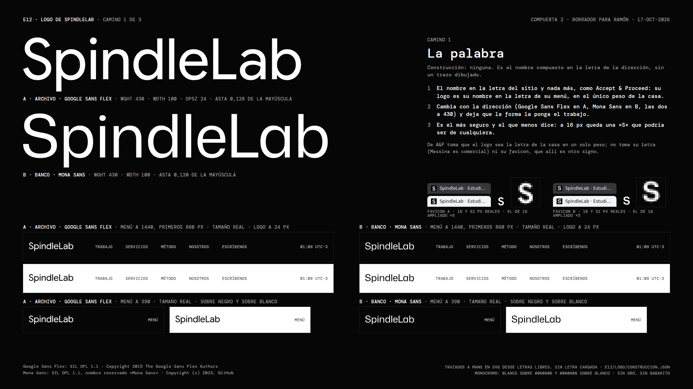
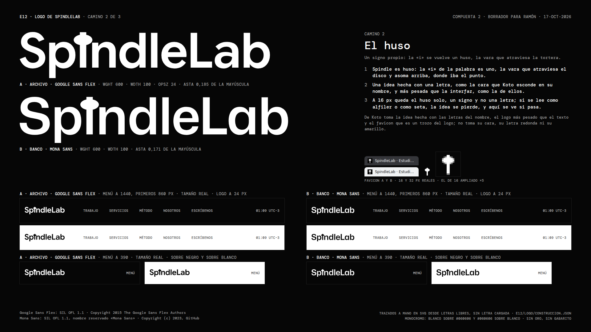

# E12 · Logo de SpindleLab: tres caminos de wordmark para la compuerta 2

**17-oct-2026 · Bruno (dirección creativa)** · rama `claude/magical-franklin-ckfki2` · encargo: `e12/encargo-paso-2.md` §4
y criterio 15. **Manda** la compuerta 1 del 16-oct: punto 7 («en diseño regirse por la referencia. el manual antiguo
se olvida») y punto 9 (dos o tres caminos de wordmark junto con las direcciones). Después, `lock-koto.md` §6 y §20.

**Estado:** borrador para que Ramón elija en la compuerta 2. Nada está publicado y `spindlelab-astro/` no se tocó. Lo
que se elige aquí es el **camino**. El dibujo final se hace con la dirección elegida, después de la compuerta (encargo
§8.4).

## 0 · En una línea

Tres caminos tipográficos y monocromos, cada uno con una sola idea: **1 · La palabra** (el nombre en la letra del
sitio, sin dibujo, como Accept & Proceed), **2 · El huso** (la «i» de Spindle se vuelve un huso: un signo propio, como
la cara que Koto esconde en su nombre) y **3 · Dos cortes** (Spindle en la sans de la dirección y LAB en la mono del
sitio). Los tres van en versión A (Google Sans Flex) y B (Mona Sans), en blanco sobre `#060606` y en `#060606` sobre
blanco, con favicon a 16 y 32 px.

**Mi recomendación: el camino 2, El huso.** Es el único con una idea que se ve a las tres escalas, y el único cuyo
favicon es un signo y no una inicial. Tiene un riesgo a la vista, que se explica en §4.

| Lámina (1920 × 1080) | Qué muestra |
|---|---|
| [`laminas/camino-1-la-palabra.png`](laminas/camino-1-la-palabra.png) | El camino 1 |
| [`laminas/camino-2-el-huso.png`](laminas/camino-2-el-huso.png) | El camino 2 |
| [`laminas/camino-3-dos-cortes.png`](laminas/camino-3-dos-cortes.png) | El camino 3 |

Cada lámina trae el wordmark grande en A y en B. Trae el menú del sitio a 1440 (los primeros 860 px) y a 390, a tamaño
real, sobre negro y sobre blanco, con el logo a 24 px. Trae el favicon a 16 y 32 px reales, en una pestaña oscura y en
una clara, más el de 16 ampliado ×5 para ver los píxeles. Cierra con el porqué en tres líneas, lo que toma de la
referencia y la licencia de cada letra. Los menús completos, a ancho real, están en `laminas/menu/`: son 24 capturas
(3 caminos, A y B, 1440 y 390, negro y blanco).

---

## 1 · Cómo resuelven su marca Koto y Accept & Proceed (medido)

El 17-oct medí en el navegador la home de los dos a 1440 (dpr 1) y a 390 (dpr 2, como teléfono). Usé el DOM, la caja de
cada elemento, la captura del logo a 4x y los favicon que declara cada sitio. El script es
`herramientas/medir-marcas.mjs`; los datos quedan en `medicion/marcas.json` y las capturas en `medicion/capturas/`.
Las capturas y los favicon bajados son para estudio interno y nada de eso entra al sitio.

| | **Koto** | **Accept & Proceed** |
|---|---|---|
| Qué es | Un SVG de **5 trazados** (`viewBox 0 0 52 26`, 2:1), sin `<text>` | Un **PNG** de 328 × 43 (2x) que se muestra a 164 × 21,5 |
| La idea | **Una cara escondida en el nombre**: «oto» hace los ojos y la nariz, y bajo ellos va una sonrisa. Es su valor declarado, el optimismo («Built on optimism», medido en el paso 1) | **Ninguna dibujada**: es el nombre «Accept & Proceed» compuesto en la letra de su menú (a la vista, la misma de «Work», comparadas en la captura a 4x), en su único peso |
| Peso contra la interfaz | **Más pesado**: asta de 3,5 px contra una mayúscula de 19,5 px (0,18), con remates redondos, mientras la interfaz va en 300 y 350 | **Igual**: asta de unos 1,9 px contra una mayúscula de 16,25 px (0,12), el mismo peso que el texto |
| Tamaño en el menú a 1440 | 52 × 26 arriba; **al plegarse el encabezado baja a 42 × 21** (escala 0,81 en 417 ms, `cubic-bezier(.03,0,0,1)`) | 164 × 21,5, fijo, en x 44 (el margen) |
| Tamaño a 390 | **59 × 29,5: más grande que en escritorio** | 164 × 21,5, en x 16 |
| Contra la letra del menú | Mayúscula del logo 19 px contra 8 px de la mayúscula de «WORK» (Mono 11, mayúsculas): **2,4 veces** | Mayúscula del logo 16 px contra 13 px de «Work» (Messina 17): **1,2 veces** |
| Color | **`#FFE800`, el único color de todo el sitio** (0 textos, 0 fondos, medido en el paso 1) | Negro sobre papel `#f9f7f3`; ningún color |
| Favicon | **La K sola**, amarilla sobre `#060606`, en `.ico` de 48 y SVG de 16; el logo entero en el `apple-touch-icon` de 180 | **Otro signo**: una «A» de dos trazos dentro de un cuadrado, en línea, blanco sobre negro (PNG de 32 y de 256) |
| Accesibilidad | El enlace del logo **no tiene nombre**: sin texto, sin `aria-label`, y el SVG sin `title`. En el árbol de accesibilidad queda «link» con una imagen sin nombre | El `alt` del logo está **vacío** y el enlace no tiene texto: «link» sin nombre |

**Lo que se toma.** De Koto, tres cosas: una sola idea hecha con las letras del nombre, el favicon que es un trozo del
logo y la proporción con el menú (2,4 veces la mayúscula del rótulo). De A&P, otras dos: el logo puede ser la letra
de la casa sin ningún dibujo, y se escribe a la izquierda en el margen. **Lo que no se toma:** la cara ni la letra
redonda y pesada de Koto, su amarillo, la letra de A&P (Messina es comercial) y su signo de favicon. Tampoco los dos
defectos medidos, el logo sin nombre accesible en los dos sitios. Cada SVG de aquí lleva `role="img"`,
`aria-label` y `<title>SpindleLab</title>`.

## 2 · Lo que comparten los tres caminos

- **Tipográficos, hechos a mano en SVG.** Los contornos salen de letras libres y se escriben como trazados, sin
  `<text>` y sin cargar ninguna letra. Quien vea el logo no necesita tener la fuente. Lo hace
  `herramientas/construir.py`: instancia la letra variable en su corte, la compone con HarfBuzz (avances y kerning del
  archivo), suma el espaciado escrito a mano y dibuja lo propio de cada camino.
- **Letras y licencias** (las tres SIL OFL 1.1; las licencias quedan copiadas en `fuentes/`):
  - **Google Sans Flex** · Copyright 2015 The Google Sans Flex Authors · `fuentes/OFL-google-sans-flex.txt`.
  - **Mona Sans** · Copyright (c) 2023, GitHub, nombre reservado «Mona Sans» · `fuentes/OFL-mona-sans.txt`.
  - **DM Mono 500** · Copyright 2020 The DM Mono Project Authors · `fuentes/OFL-dm-mono.txt`.

  La OFL permite usar los contornos en un logo. Lo que prohíbe es vender el archivo de la letra o distribuir una
  versión modificada con el nombre reservado, y aquí no se distribuye ninguna letra: se distribuyen dibujos hechos a
  partir de ella. Las dos sans se bajan de Google Fonts a un temporal y no se guardan (Google Sans Flex pesa 763 kB);
  la URL exacta del archivo usado queda en `construccion.json`. Solo DM Mono (15 kB) vive en `fuentes/`, porque
  las láminas la usan para el texto.
- **Monocromo.** Blanco `#FFFFFF` sobre el lienzo `#060606`, y `#060606` sobre blanco, con 20,26:1 en los dos
  casos. **Sin oro y sin Gabarito**: el manual antiguo no rige este sitio (compuerta 1, punto 7) y ninguno de los
  dos aparece por herencia. **Sin color**, porque el lock §20.4 deja la señal en la opción (a), cero color de
  interfaz, y Koto tiene su color solo en el logo; si Ramón quiere ese gesto, el color tiene que salir de la dirección
  elegida (§8).
- **En el menú a 24 px de alto** (de lo más alto de la «d» o la «L» a lo más bajo de la «p»). La mayúscula queda en
  18,1 a 19,3 px contra 7,7 px de la mayúscula del rótulo (DM Mono 500, 11 px). Son **2,35 a 2,5 veces, la proporción
  de Koto** (2,4) y no la de A&P (1,2). El logo va en x 16, que es el margen del lock, a 1440 y a 390. Los enlaces
  empiezan 60 px después del logo, como en Koto, y el menú va en DM Mono 500 de 11 px, en mayúsculas y con +0,03em
  (lock §6.3). El texto es el de Clara (`texto/texto-paso2.json`, `comun.nav`). El blanco al 70 % da 9,77:1 sobre
  negro, y la tinta al 70 %, 7,94:1 sobre blanco. La hora es la del visitante con su huso, calculada al abrir (lock
  §11). **«Menú», el rótulo del botón a 390, no está en el texto de Clara:** lo puse por el patrón de Koto («Menu») y
  Clara lo confirma o lo cambia.
- **Sobre negro y sobre blanco.** El lock §20.2 no pone nunca la interfaz sobre un campo de color: el blanco y los
  colores van dentro de los marcos del trabajo. Por eso el logo se prueba sobre el lienzo negro y sobre blanco, que es
  el único otro lienzo posible si Ramón pide una interior clara (el desvío de Koto que el lock §20.6 deja rotulado).
- **Favicon en una retícula de 32**, con su propio cuadrado `#060606` como Koto. Así se ve igual en una pestaña oscura
  y en una clara. Las letras del favicon van en **wght 600** (`PESO_FAVICON`), porque a 16 px un asta de 430 cae en
  medio píxel y se pinta gris (lo vi en la primera vuelta). Es corrección óptica de tamaño chico, y el dibujo de la
  letra no cambia. La línea de base y el asta de la «L» caen en unidades pares, que a 16 px son píxeles enteros.

## 3 · Camino 1 · La palabra



**La idea:** el nombre en la letra del sitio y nada más. **En qué difiere de los otros:** no tiene construcción, ni
un solo trazo dibujado. Es el lenguaje de Accept & Proceed.

- **Construcción.** «SpindleLab» en la sans de la dirección a **wght 430**: Google Sans Flex (wdth 100, opsz 24) en A
  y Mona Sans (wdth 100) en B. Es el peso del texto, como A&P, que usa el único peso de su casa. El asta mide 0,128 de
  la mayúscula en A y 0,120 en B (A&P: 0,12). La interletra es de −10 milésimas de la mayúscula, más un ajuste del par
  «eL» (−14 en A, −12 en B) para que la L mayúscula no abra un hueco en medio de la palabra.
- **A 24 px:** 123 × 24 px en A y 135 × 24 en B. Se lee entero en los dos.
- **Favicon:** la «S» sola, en wght 600. Se lee nítida a 16 px, y es la parte débil del camino: es una «S» como la de
  cualquiera.
- **Lo que toma de la referencia:** de A&P, el logo como letra de la casa en un solo peso. No toma su letra ni su
  signo de favicon.
- **Riesgo:** que no diga nada. Si cambia la dirección, cambia el logo, que es el punto del camino y también su
  fragilidad. Y en A tiene el mismo problema que el lock §6.2 le marca a la dirección: el nombre del estudio escrito en
  la letra de los productos de Google.
- **Archivos:** `camino-1-la-palabra/camino-1-la-palabra-{A,B}-{blanco,negro}.svg`, `favicon-{A,B}.svg` y sus PNG de
  16 y 32.

## 4 · Camino 2 · El huso (el que recomiendo)



**La idea:** *spindle* es huso, y la «i» de la palabra es uno. La vara es el asta de la «i», que sigue de largo,
atraviesa la tortera (el disco del huso, visto un poco desde arriba) y asoma por encima, donde iba el punto. **En qué
difiere de los otros:** es un signo propio metido en la palabra. Es el lenguaje de Koto: una idea hecha con las letras
del nombre, y un logo más pesado que el texto.

- **Construcción.** La palabra va en **wght 600**, más pesada que la interfaz, como el logo de Koto (asta de 0,185 de
  la mayúscula en A y 0,171 en B; Koto, 0,18). La «i» se reemplaza por el huso, dibujado con el asta de la propia
  letra (`huso()` en `construir.py`). La tortera es una lente de 2,9 × 1,7 astas, con el centro a un cuarto de su alto
  sobre la x. La vara asoma un tercio de asta por encima de la tortera, de modo que la punta queda donde estaba el
  punto (en A, 101,8 contra 105,4 de la «i» original, en unidades donde la mayúscula mide 100). La interletra es de
  −14 milésimas, se abre +6 a cada lado de la «i» para que la tortera no toque a la «p» ni a la «n», y el par «eL» se
  ajusta a −16 en A y −14 en B.
- **A 24 px:** 130 × 24 px en A y 139 × 24 en B. A ese tamaño la tortera se funde en un punto grueso pegado al asta y
  la palabra se lee «SpindleLab».
- **Favicon:** el huso solo, dibujado en la retícula (vara de 2 × 12,5 px y tortera de 8 × 5 px, con la punta de 1 px a
  16 px). Es un signo y no una inicial, como la K de Koto es un trozo de su logo.
- **Lo que toma de la referencia:** de Koto, la idea hecha con una letra del nombre, el peso por encima del texto y el
  favicon sacado del logo. No toma su cara, su letra redonda ni su amarillo.
- **Riesgo, dicho mirándolo:** en grande y a 16 px el huso también se lee como **alfiler, cerradura o seta**. Quien no
  ha visto nunca un huso de hilar no va a ver uno. La idea se sostiene igual por el nombre (es la «i» de *Spindle*),
  pero si en la lámina Ramón ve una cerradura, se lo va a ver todo el mundo. En la primera vuelta, con la tortera plana
  y la vara larga, se leía como **una cruz** («†»), y eso lo corregí (§9). El dibujo final, si se elige, prueba la
  tortera contra esas tres lecturas.
- **Movimiento (propuesta, no construido):** la tortera puede girar sobre la vara (una escala horizontal de 1 a −1 y
  de vuelta) cuando la página carga o al pasar el mouse por el logo. Con `prefers-reduced-motion`, quieta. Es el único
  de los tres caminos que tiene un movimiento propio; el de Koto es plegarse a 0,81.
- **Archivos:** `camino-2-el-huso/camino-2-el-huso-{A,B}-{blanco,negro}.svg`, `favicon.svg` (sirve para A y B) y sus
  PNG de 16 y 32.

## 5 · Camino 3 · Dos cortes


**La idea:** las dos voces del sitio dentro del nombre. «Spindle» va en la sans de la dirección y «LAB» en DM Mono
500, en mayúsculas, con la mayúscula a la altura de la x y +0,03em, que es el rótulo del sitio (lock §6.3) puesto dentro
de la palabra. **En qué difiere de los otros:** está construido con dos letras. Es el sistema de Koto, que usa una
letra en tres cortes, con la mono como voz de los datos.

- **Construcción.** El peso de la sans se calcula para que su asta iguale la de «LAB» a ese tamaño: **wght 359 en A y
  393 en B**, con el asta en 0,108 y 0,109 de la mayúscula. El hueco entre la «e» y la «L» es el de la propia sans
  entre «e» y «l», más 10 milésimas.
- **A 24 px:** 115 × 24 px en A y 127 × 24 en B. «LAB» se lee como versalitas.
- **Favicon:** la «S» de la sans en wght 600 y la «L» de la mono a la altura de su x, como en la palabra. A 16 px se
  lee «SL».
- **Lo que toma de la referencia:** de Koto, el sistema de una letra en cortes. No toma su letra ni su logo.
- **Ventaja práctica:** la mitad en DM Mono no cambia si cambia la dirección, porque A y B la comparten.
- **Riesgo:** que «LAB» en mono se lea como el sufijo de cualquier marca de tecnología, o como el disfraz de
  laboratorio que el lock §6.3 y el brief §4 sacaron del sitio («[ LAB_STATUS ]»). Es además el más liviano de los tres
  (asta de 1,96 px a 24 px en A).
- **Primera vuelta descartada:** probé primero «Lab» en mono y caja normal, a la misma altura de mayúscula que la sans.
  A 24 px no se veía como idea sino como un error de espaciado («SpindleL ab»), y la cambié (§9).
- **Archivos:** `camino-3-dos-cortes/camino-3-dos-cortes-{A,B}-{blanco,negro}.svg`, `favicon-{A,B}.svg` y sus PNG de
  16 y 32.

## 6 · Los tres, lado a lado

| | 1 · La palabra | 2 · El huso | 3 · Dos cortes |
|---|---|---|---|
| Lo que lo hace distinto | Nada dibujado | Un signo propio en la «i» | Dos letras en una palabra |
| Lenguaje | Accept & Proceed | Koto (la idea en las letras) | Koto (la letra en cortes) |
| Peso (A / B) | 430 / 430 | 600 / 600 | 359 / 393 + DM Mono 500 |
| Asta / mayúscula (A / B) | 0,128 / 0,120 | 0,185 / 0,171 | 0,108 / 0,109 |
| A 24 px de alto (A / B) | 123 / 135 px de ancho | 130 / 139 | 115 / 127 |
| Favicon | «S» | El huso | «S» + «L» |
| ¿Cambia con la dirección? | Entero | La letra de alrededor; el huso, no | Spindle sí; LAB, no |
| Riesgo | Que no diga nada | Alfiler, cerradura o seta | Sufijo de tecnología |

## 7 · Lo que decide Ramón

1. **¿Qué camino?** (encargo §10.2). Si ninguno, se vuelve a la medición de §1, no a estas láminas.
2. Con el camino, **la dirección** (A o B) fija la letra del dibujo final, salvo la mitad «LAB» del camino 3.
3. **¿El logo lleva color?** Por defecto, no (§2). Si quiere el gesto de Koto, con el logo como único color del sitio,
   lo dice aquí y el color se decide con la dirección, no con el manual antiguo.

## 8 · Lo que no se hizo, y por qué

- **El dibujo final:** se hace después de elegir (encargo §8.4). Estos SVG son caminos, con la letra de partida y un
  ajuste de espaciado a mano. Faltan el ajuste óptico de curvas, las versiones para tamaños de 12 a 16 px fuera del
  favicon y la prueba en papel.
- **El color:** el lock §20.4 rige la opción (a), cero color de interfaz. Un logo de color sería el único color de la
  interfaz, que es justo el gesto de Koto, y eso lo decide Ramón (§7.3).
- **El movimiento del logo:** queda descrito (camino 2) y no construido. El tablero de las direcciones decide si el
  encabezado se pliega como el de Koto.
- **`apple-touch-icon`, avatar de redes y versión para documentos:** van después, con el dibujo final.
- **Generación pagada:** ninguna. Todo sale de letras libres, de código y del navegador.

## 9 · Historial de correcciones

| Fecha | Corrección | Origen |
|---|---|---|
| 17-oct | Camino 2: con la tortera plana (3 × 1 astas) y la vara asomando media asta sobre el punto original, la «i» se leía como **una cruz** en grande, a 24 px y en el favicon. La tortera pasa a una lente gorda (2,9 × 1,7 astas) sentada sobre la x, y la punta a un tercio de asta. El favicon pasa a una tortera de 8 × 5 px y una punta de 1 px | Mirando la primera lámina y el favicon ampliado |
| 17-oct | Camino 3: «Lab» en mono y caja normal, a la altura de la mayúscula, se leía como un error de espaciado a 24 px. Pasa a «LAB» en mayúsculas a la altura de la x, que es la forma del rótulo del sitio | Primera vista previa |
| 17-oct | Favicon de los caminos 1 y 3: en el peso del wordmark (430 y 360), la «S» de 16 px quedaba gris. Las letras del favicon pasan a wght 600, y la línea de base y el asta de la «L» caen en píxeles enteros | Favicon ampliado ×8 |
| 17-oct | Lámina: el bloque del favicon se montaba sobre el menú. Se reordenó y `render.mjs` comprueba ahora que los bloques no se pisen | Primera lámina |
| 17-oct | Lámina 2: «un signo que no tiene ningún otro estudio» no se puede comprobar y salió. Lámina 1: A&P «en Messina Sans» pasó a «en la letra de su menú», porque su logo es un PNG y la letra solo se compara a la vista | Revisión del texto antes de entregar |

## 10 · Cómo rehacerlo

```
cd marketing/oficina/obras-web/spindlelab-v3/e12/logo
node herramientas/medir-marcas.mjs medicion/marcas.json medicion/capturas   # Koto y A&P (red, por el proxy)
python3 -I herramientas/construir.py .        # SVG de los tres caminos y construccion.json (baja las dos sans)
python3 -I herramientas/armar-laminas.py .    # láminas y menú en HTML
node herramientas/render.mjs .                # PNG de láminas, menús y favicon; laminas/render.json
```

`construir.py` da los mismos SVG en cada corrida mientras Google Fonts sirva el mismo archivo (la URL de cada uno
queda en `construccion.json`). Las láminas y los menús cambian solo en la hora, porque es la del momento de
renderizar. `render.json` registra cada corrida: las 3 láminas con todas sus imágenes cargadas, el logo a 24 px en
cada menú, ningún desborde, ningún bloque pisado, ningún texto bajo 11 px y cero errores de consola. Los 24 menús van
sin desborde y con DM Mono cargada.

**Archivos:** `caminos.md` (este) · `construccion.json` · `camino-1-la-palabra/`, `camino-2-el-huso/`,
`camino-3-dos-cortes/` (SVG, favicon SVG y PNG) · `laminas/` (3 láminas en HTML y PNG, `menu.html`, `menu/` con 24
PNG, `caminos.json` y `render.json`) · `medicion/` (`marcas.json` y `capturas/`) · `herramientas/` (`medir-marcas.mjs`,
`construir.py`, `armar-laminas.py` y `render.mjs`) · `fuentes/` (DM Mono 500 y las tres licencias).
