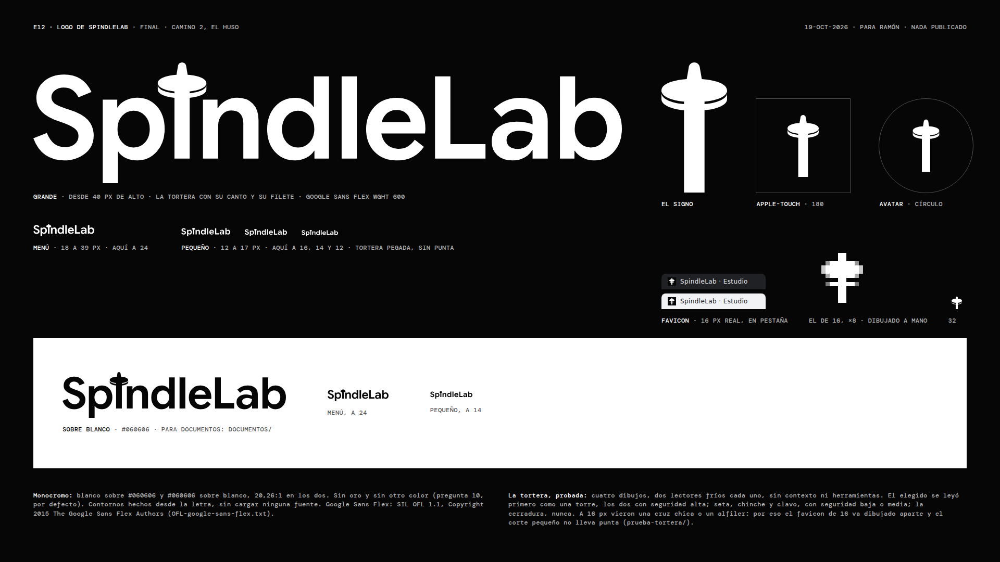

# E12 · Logo de SpindleLab, final: camino 2, «El huso»

**19-oct-2026 · Bruno (dirección creativa)** · rama `claude/magical-franklin-ckfki2` · manda el brief, sección
«Compuerta 2», punto 2 (`e12/brief-de-obra.md`): camino 2, monocromo (pregunta 10, por defecto) y en Google Sans Flex
wght 600, la letra de A. **Nada está publicado y `spindlelab-astro/` no se tocó:** estos archivos los copia Diego en la
corrida 2, contra la spec de Lucía. El camino y su historia están en `../caminos.md` (§11 cierra lo de hoy).

## En una línea

La «i» de SpindleLab es un huso: la vara es el asta de la letra, atraviesa una tortera dibujada como un **disco con
canto** (la cara de arriba, el canto debajo y un filete negativo entre los dos) y asoma por arriba en una punta que se
afina. Va en **tres cortes según el tamaño** (grande, menú y pequeño), con un signo suelto, favicon, iconos, avatar y
versión para documentos, en blanco sobre `#060606` y en `#060606` sobre blanco.



## Qué archivo va dónde

| Archivo | Qué es | Dónde va |
|---|---|---|
| `logo-menu-blanco.svg`, `logo-menu-negro.svg` | El corte **menú**: la tortera sin el filete | **De 18 a 39 px de alto.** El encabezado y el pie del sitio. En línea en el HTML, con `fill="currentColor"` en vez del color |
| `logo-grande-blanco.svg`, `logo-grande-negro.svg` | El corte **grande**: el dibujo entero, con el filete | **Desde 40 px de alto.** Portadas, láminas, presentaciones, letreros |
| `logo-pequeno-blanco.svg`, `logo-pequeno-negro.svg` | El corte **pequeño**: Google Sans Flex en opsz 12, tortera pegada a la vara y sin punta, interletra abierta | **De 12 a 17 px de alto.** Pies muy chicos, créditos, firmas de correo |
| `pequeno/spindlelab-pequeno-{blanco,negro}-{12,14,16}{,@2x}.png` | El corte pequeño en PNG, fondo transparente, a 12, 14 y 16 px de alto y al doble | Donde no entra un SVG: la firma de correo (se pone el `@2x` con el ancho del de 1x) |
| `signo-blanco.svg`, `signo-negro.svg` | El huso solo, del corte grande | Donde el nombre ya está al lado: avatar, sello, marca de agua |
| `favicon.ico` | 16 (dibujado a mano), 32 y 48 en un solo archivo | `/favicon.ico` del sitio |
| `favicon-16.png` | El de 16 px, **dibujado píxel a píxel** | `<link rel="icon" sizes="16x16">` |
| `favicon-32.png`, `favicon-48.png` | De `favicon.svg`, a 32 y 48 | `<link rel="icon" sizes="32x32">` |
| `favicon.svg` | El huso en una retícula de 32, con canto y filete | Solo si se acepta que a 16 px se ensucie (abajo). No es el recomendado |
| `apple-touch-icon.png` | 180 × 180, el signo a 66 % del alto sobre `#060606` | `<link rel="apple-touch-icon">` (iOS redondea las esquinas) |
| `icon-192.png`, `icon-512.png` | El signo a 60 % del alto, dentro del círculo seguro del 80 % | El `manifest` (Android), sirven como `any` y como `maskable` |
| `avatar/avatar-cuadrado-1080.png` | 1080 × 1080, el signo a 56 % del alto sobre `#060606` | **El que se sube** a LinkedIn, Instagram y Google (la red lo recorta en círculo y el signo queda dentro) |
| `avatar/avatar-redondo-1080.png` | El mismo, recortado en círculo, esquinas transparentes | Donde el círculo se ve: una presentación, un documento, una firma |
| `documentos/spindlelab-{negro,blanco}.svg` | El corte grande (copia) | Propuestas, cotizaciones, membretes: el negro sobre papel blanco |
| `documentos/spindlelab-{negro,blanco}-2400.png` | El mismo a 2400 px de ancho, fondo transparente | Word, Google Docs, Canva o donde no entre un SVG (a 300 ppp mide 20 cm: alcanza para cualquier tamaño de hoja) |
| `OFL-google-sans-flex.txt` | La licencia de la letra | Va con el logo: los contornos salen de una letra OFL |
| `lamina-final.png` (y `.html`) | La lámina de cierre, 1920 × 1080 | Para Ramón |
| `construccion-final.json` | Cada número del dibujo, por corte | Para rehacerlo o medirlo |
| `render.json`, `lamina-final.json` | Lo comprobado al rasterizar | Para la QA |
| `prueba-tortera/` | La prueba contra alfiler, cerradura y seta: capturas a dpr 1 y 2 y lo que dijo cada lector | Para la QA y para Ramón |
| `movimiento/` | El giro de la tortera: **propuesto, no entra al logo** (abajo) | Para la spec, si lo quiere |

**En el `<head>` del sitio** (lo decide la spec; esto es lo que los archivos permiten):

```html
<link rel="icon" href="/favicon.ico" sizes="48x48">
<link rel="icon" href="/favicon-32.png" type="image/png" sizes="32x32">
<link rel="icon" href="/favicon-16.png" type="image/png" sizes="16x16">
<link rel="apple-touch-icon" href="/apple-touch-icon.png">
```

y en el `manifest`: `{"src": "/icon-192.png", "sizes": "192x192", "type": "image/png", "purpose": "any maskable"}` y
el mismo con `icon-512.png`. **Sin `favicon.svg` en el `<head>`:** Chrome y Firefox prefieren el SVG si está declarado,
y a 16 px el SVG pinta 26 píxeles grises contra 10 del dibujado a mano (medido rasterizando los dos a 16 × 16).

## Cómo se usa

- **El corte va por el alto al que se ve, no por gusto:** 12 a 17 px, pequeño; 18 a 39, menú; 40 o más, grande. Bajo 12
  px no hay logo: va el favicon o el nombre en texto.
- **A 24 px de alto** (el menú de A) el logo mide **117 × 24 px**, la mayúscula 16,3 px y el asta 3 px. El camino que
  vio Ramón medía 130 × 24 con la mayúscula en 18,1, porque su punta era más baja. Si la spec quiere la mayúscula de
  antes, el logo va a **26,6 px** de alto; si quiere los 24, la proporción con el rótulo del menú (DM Mono 11) queda en
  2,1 veces, contra 2,4 de Koto.
- **Aire alrededor:** al menos la altura de la x del propio logo por los cuatro lados (en el SVG, 72 unidades de 147 de
  alto: un 49 % del alto del logo). Ningún otro elemento dentro de ese aire.
- **Color:** blanco `#FFFFFF` sobre `#060606` o `#060606` sobre blanco (20,26:1 en los dos). Sobre una foto o un video,
  solo si el fondo detrás del logo es lo bastante oscuro o claro para pasar 4,5:1; si no, no va. Sin oro, sin otro
  color, sin degradé, sin sombra.
- **Nombre accesible:** cada SVG trae `role="img"`, `aria-label="SpindleLab"` y `<title>`. En línea dentro de un
  enlace, el enlace lleva el nombre («SpindleLab, inicio») y el SVG puede ir con `aria-hidden="true"`. Koto y A&P tienen
  el logo sin nombre (medido el 17-oct): eso no se copia.
- **No se redibuja, no se estira, no se le cambia la letra.** Si hace falta otra cosa, se pide aquí.

## Lo que cambió desde el camino que eligió Ramón

El camino (`../camino-2-el-huso/`, 17-oct) era el arranque, con el riesgo escrito: la tortera, una elipse gorda pegada
a la vara con una punta corta, se podía leer como alfiler, cerradura o seta. Lo que hice hoy, en orden:

1. **La prueba de la tortera** (abajo). Dibujé 17 variantes, descarté 13 mirándolas y llevé 4 a la lectura fría. Ganó
   el disco con canto.
2. **El disco con canto.** La cara es una superelipse con los hombros un 8 % más llenos que una elipse (se lee como
   disco y no como bola), de 3,2 × 1,55 astas; el canto mide 0,42 astas y el filete que lo separa de la cara, 0,12. La
   tortera flota sobre la altura de la x, como el punto de la «i», con su borde de abajo a 0,1 asta de la x; así no
   choca con la «p» ni con la «n» y no hace falta abrir el espaciado alrededor (el camino lo abría +6 a cada lado). El
   aire medido entre la tortera y la «n» es de 0,32 astas, y con la «p», de 0,90.
3. **La punta:** la vara sigue sobre la tortera 0,8 astas, se afina a 0,55 del asta y termina redonda. Queda en 117
   unidades (la mayúscula mide 100 y el punto de la «i» original llegaba a 105).
4. **Tres cortes por tamaño**, que es lo que hace la propia letra con su eje de tamaño óptico (opsz): a 12 px Google
   Sans Flex es un 8 % más ancha y abierta que a 24. **El menú** pierde el filete, que a 24 px mide 0,4 px y solo
   ensucia la tortera. **El pequeño** usa la letra en opsz 12 y wght 620, la tortera más chica (2,5 × 1,55 astas),
   pegada a la vara y **sin punta**, y abre la interletra +8 milésimas: los dos lectores del logo chico lo prefirieron
   sobre el punto suelto y sobre el grande achicado, que leyeron «Sp†ndleLab» y con «nd» y «le» pegadas.
5. **Contornos limpios:** cada trazado sale unido con skia-pathops. La letra instanciada traía 56 tramos de largo cero en
   las curvas; el logo, ninguno. Cada corte es un solo `<path>`, sin `<text>` ni letra cargada.
6. **El favicon de 16, a mano.** A 16 px ningún vector escalado se lee: la tortera lisa se lee cruz y la tortera con
   canto se ensucia de gris. Está dibujado píxel a píxel: cara de 10 × 4 px, filete de 1, canto de 8 × 1, vara de 2 y
   punta de 2 × 2. El de 32 y el de 48 salen de `favicon.svg`, que es ese mismo dibujo al doble y con curvas. El
   `favicon.ico` lleva los tres, y su 16 es el dibujado (comprobado píxel a píxel).
7. **Lo que no cambió:** la idea (la «i» como huso), la letra (Google Sans Flex wght 600, opsz 24, la de A), el
   espaciado general (−14 milésimas y el par «eL» a −16) y el monocromo.

## La prueba de la tortera

**El método.** El lector es Claude Code (`claude -p`) en un directorio vacío, en una conversación nueva cada vez, sin
herramientas, sin skills, sin servidores MCP, sin ajustes ni CLAUDE.md, y sin las variables de entorno que apuntan a
los repos o a esta sesión (`herramientas/lector-frio.py`). Antes de correrlo comprobé que, a la pregunta de copiar
cualquier nombre de empresa, marca o proyecto de su contexto, no aparece SpindleLab ni nada del estudio. Las imágenes
van dentro del mensaje, sin nombre de archivo. **Dos lectores por variante**, cada uno en su conversación. Tres turnos:
(1) el signo solo, a 240, 48, 32 y 16 px, a dpr 1 y a dpr 2, más los dos chicos ampliados para ver los píxeles: «¿qué
objeto ves?», abierta; (2) ordenar una lista fija (alfiler, ojo de cerradura, seta, huso con su tortera, cruz, trompo,
clavo, chinche); (3) el signo dentro del logo, a 120, 24, 16 y 12 px y sobre blanco: «¿qué dice?, ¿qué letra cuesta?».
Las capturas son las de `prueba-tortera/<variante>/` (comprobadas píxel a píxel contra las que vio el lector) y las
respuestas, íntegras, en `lector-1.json` y `lector-2.json`.

**Lo que vale y lo que no.** Es una lectura simulada: sirve para encontrar qué se ve en la forma sin contexto, no para
medir cuánta gente lo ve. Con dos lectores por variante, una diferencia de un puesto en la lista es ruido. Y el turno 3
no prueba la tortera: el lector sabe inglés y, al leer «Spindle», sabe que es un huso; el visitante chileno, casi
nunca.

| Variante | Primera lectura (los dos lectores) | Alfiler, cerradura y seta en la lectura abierta | En la lista (puesto de 8; 8 = descartada) | Lo nuevo que apareció |
|---|---|---|---|---|
| **v0 · el camino** (la de la compuerta) | Torre de agua o de control, «tipo Torre Entel» (media-alta) | Alfiler 2 de 2 (baja), seta 2 de 2 (baja y media), cerradura 0 | Alfiler 2 y 4 · cerradura 6 y 6 · seta 4 y 2 | A 16 px, flecha |
| **v2 · disco con canto (la elegida)** | Torre de observación, «tipo Space Needle» (**alta**, los dos) | Alfiler 0 en grande (1 de 2 a 16 px), seta 2 de 2 (baja), cerradura 0 | Alfiler 5 y 5 · **cerradura 8 y 8** · seta 2 y 3 | Chinche (media en uno); a 16 px, cruz chica |
| **v8 · la vara por delante, punta de ojiva** | **Daga o espada** (media), flecha (media), cohete | Ninguna de las tres | Alfiler 3 y 3 · cerradura 8 y 8 · **seta 8 y 8** | Daga y cruz (la cruz, 2.ª en la lista de los dos) |
| v9b · disco con canto, punta de aguja | Torre (alta, los dos) | Seta 2 de 2 (media y baja), alfiler 1 de 2 | Alfiler 6 y 5 · cerradura 8 y 8 · seta 2 y 2 | «Hongo con un brote o una llama encima» |

**Por qué gana la v2, y cuál es la alternativa.** La v2 es la que más se aleja del alfiler (5.º contra 3.º del camino)
y de la cerradura (descartada por los dos), y su primera lectura es una torre, con seguridad alta: una lectura neutra,
que no le quita nada a un estudio. **La seta no se va:** en la lista queda 2.ª o 3.ª, igual que en el camino. La única
variante que saca las tres malas lecturas es la **v8**, y lo hace a cambio de una peor: los dos lectores vieron primero
una daga, y la cruz quedó 2.ª. Entre una seta baja y una daga primera, recomiendo la v2. Si Ramón prefiere que la seta
no aparezca nunca aunque aparezca la daga, la v8 está dibujada (`prueba-tortera/variantes/v8-ojiva-*.svg`) y se
termina en una corrida.

**El logo, a todos los tamaños.** Los ocho lectores leyeron «SpindleLab», letra por letra, a 120, 24, 16 y 12 px y
sobre blanco. La única letra que señalaron fue la «i»: a 16 y 12 px, con cualquier tortera que tenga punta, se lee
como una «t», una cruz o una flecha, y la palabra se resuelve por contexto. Por eso existe el corte pequeño.

**El logo chico** (`prueba-tortera/pequeno/`): tres filas a 16, 14 y 12 px, a dpr 1 y 2, sin decir cuál es cuál. A, el
punto suelto; B, el corte grande achicado; C, la tortera pegada sin punta. Los dos lectores las ordenaron **C, A, B**:
C «la más ancha, con más altura de letra y más aire»; B «Sp†ndleLab», con «nd» y «le» pegadas a 12 y 14 px. C es
`logo-pequeno-*.svg` (el mismo archivo, comparado byte a byte).

## El giro de la tortera: propuesto, no entra

`movimiento/giro.html` lo muestra andando, y `movimiento/giro.css` es el CSS que haría falta. **Por qué no es la escala
que proponía el camino** (la tortera de 1 a −1 en horizontal): un disco que gira sobre su eje se ve igual en cada
instante, y una escala horizontal muestra una moneda que se da vuelta, que es otro movimiento. Lo único que deja ver un
giro es una marca que corre: aquí, una muesca que pasa por el frente del canto, dos vueltas que frenan, en 1,6 s, al
cargar y al pasar el mouse o el foco por el logo. En reposo la muesca queda detrás de la vara y el logo es idéntico al
quieto. **Comprobado** (`movimiento/giro.json`, `fotogramas.png`): con `prefers-reduced-motion: reduce` corren 0
animaciones, también con el mouse encima, y la muesca queda en `scaleX(0)`; cero errores de consola.

**Por qué no lo firmo:** la muesca mide 0,4 astas de ancho, o sea 1,2 px en el menú a 24 px: ahí no se ve, y el menú es
donde más se ve el logo. Solo se lee desde unos 100 px de alto. Y lo revisé en fotogramas detenidos, no corriendo: en la
primera prueba (tres vueltas en 1,2 s) la muesca saltaba en vez de correr, y lo bajé a dos vueltas en 1,6 s, pero el
juicio de si «se ve girar» se hace mirándolo andar, y eso aquí no se pudo. Queda para que Lucía lo vea en el navegador
y la spec decida; si entra, solo en el corte grande.

## Lo que no se hizo

- **Ninguna generación ni gasto.** Todo sale de la letra libre, de código y del navegador.
- **Ningún color en el logo** (pregunta 10, por defecto). Si algún día lo lleva, es una decisión de Ramón y se hace aquí.
- **No se tocó `spindlelab-astro/`** ni el sitio publicado, que sigue con su wordmark actual.
- **No se probó con personas.** La lectura fría es simulada (arriba).
- **El favicon en Safari y en la pantalla de inicio de un iPhone real** no se vio: se ve en la corrida 2.

## Licencia

Google Sans Flex, Copyright 2015 The Google Sans Flex Authors, bajo la SIL Open Font License 1.1 (`OFL-google-sans-flex.txt`,
copiada de `../fuentes/`). La OFL permite usar los contornos en un logo; lo que no permite es vender el archivo de la
letra ni distribuir una versión modificada con su nombre reservado. Aquí no se distribuye ninguna letra: se distribuyen
dibujos hechos a partir de ella. La letra se baja de Google Fonts a un temporal y no se guarda; el archivo exacto está
en `construccion-final.json` (`letra.archivo`, la versión v23, la misma de los caminos del 17-oct).

## Cómo rehacerlo

```
cd marketing/oficina/obras-web/spindlelab-v3/e12/logo
python3 -I herramientas/final.py .            # SVG de los tres cortes, el signo, favicon.svg y favicon-16.png; construccion-final.json
node herramientas/final-render.mjs .          # los PNG (favicon 32 y 48, iconos, avatar, documentos, pequeño); render.json
python3 -I herramientas/ico.py final          # favicon.ico con 16, 32 y 48
node herramientas/lamina-final.mjs .          # la lámina y lamina-final.json
python3 -I herramientas/giro.py . <letra.woff2> && node herramientas/giro-fotogramas.mjs .   # el giro propuesto
# la prueba de la tortera
python3 -I herramientas/explorar.py . <letra.woff2> final/prueba-tortera/variantes
node herramientas/prueba-capturas.mjs final/prueba-tortera/variantes final/prueba-tortera v0-camino v2-disco v8-ojiva v9b-disco-aguja-corta
python3 -I herramientas/lector-frio.py final/prueba-tortera/v2-disco <salida.json> <directorio-vacío>
```

Necesita Python 3 con fontTools, uharfbuzz, brotli, skia-pathops y Pillow, `curl`, y el Chromium 141 de Playwright que
trae `spindlelab-astro`. Con la misma versión de la letra, los SVG salen idénticos byte a byte (comprobado: bajada de
nuevo, el 19-oct, no cambió ninguno) y los PNG también. La lectura fría no se repite igual: cada lector es una
conversación nueva.
