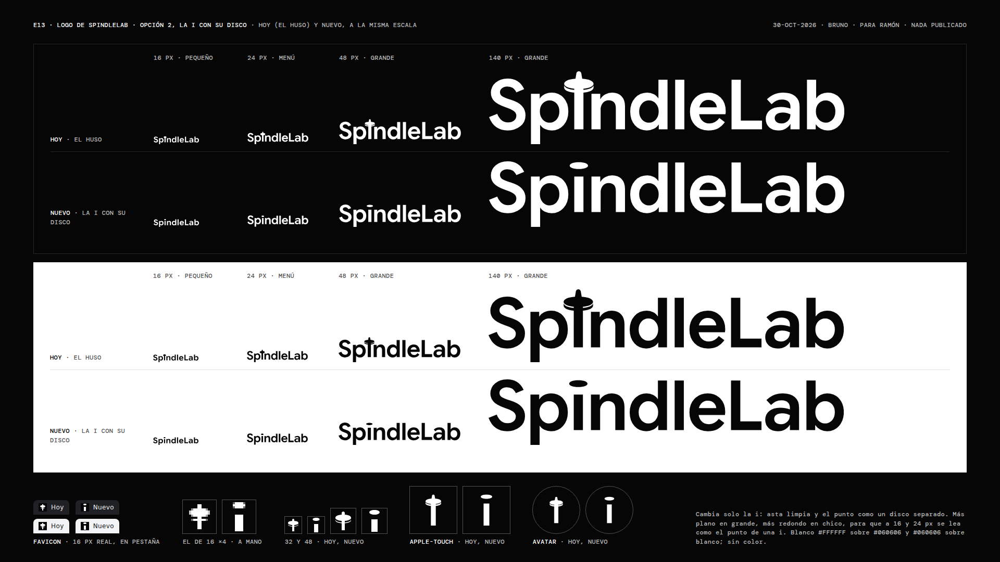

# E13 · Logo de SpindleLab, opción 2: «la i con su disco»

**30-oct-2026 · Bruno (dirección creativa)** · rama `claude/magical-franklin-ckfki2` · lo decidió Ramón el 30-oct sobre
`../copy/maquetas-30oct/logo-opciones.jpg`: «logo 2 por ahora» («la cruz de la i se ve horrible»). **Nada está publicado
y `spindlelab-astro/` no se tocó:** estos archivos los copia Diego.

## En una línea

El wordmark de El huso (`../../e12/logo/final/`) con **una sola letra cambiada**: la «i» vuelve a tener el asta limpia de
la letra, sin la vara que asomaba ni la tortera que la cruzaba, y su punto es **un disco aplanado, separado del asta**.
El disco cambia con el tamaño: plano y ancho en grande, donde tiene que notarse como disco, y más redondo en chico, donde
tiene que leerse como el punto de una «i». Tres cortes, signo, favicon, iconos, avatar y versión para documentos, en
blanco sobre `#060606` y en `#060606` sobre blanco.



## Qué archivo va dónde

| Archivo | Qué es | Dónde va |
|---|---|---|
| `logo-menu-linea.svg` | El corte **menú** en un solo `<path>`, `fill="currentColor"`, con **el mismo viewBox de `Logo.astro`** (`3.34 -117.02 716.32 147.01`) | **El encabezado y el pie del sitio.** Diego reemplaza el `d` de `src/components/a/Logo.astro` por el de este archivo y no toca nada más: el logo sigue midiendo 116,9 × 24 px a 24 de alto, con la mayúscula en 16,3 px, como hoy (comprobado: pegado en el viewBox de `Logo.astro` pinta idéntico píxel a píxel, a 1x y 2x) |
| `logo-menu-blanco.svg`, `logo-menu-negro.svg` | El mismo corte menú, en su caja justa (716,32 × 132,32) | **De 18 a 39 px de alto**, fuera del sitio: presentaciones, firmas grandes, documentos en pantalla. Ojo: en su caja justa, a 24 px de alto mide 129,9 × 24 y la mayúscula 18,1 (la caja ya no reserva el alto de la vara de El huso) |
| `logo-grande-blanco.svg`, `logo-grande-negro.svg` | El corte **grande**: el disco plano | **Desde 40 px de alto.** Portadas, láminas, letreros, las imágenes al compartir (`og-trabajo.mjs` puede volver a usar el grande a 40: ya no trae la tortera) |
| `logo-pequeno-blanco.svg`, `logo-pequeno-negro.svg` | El corte **pequeño**: la letra en opsz 12 y wght 620, interletra abierta, el disco casi redondo | **De 12 a 17 px de alto.** Pies muy chicos, créditos, firmas de correo. Bajo 12 px no hay logo: va el favicon o el nombre en texto |
| `pequeno/spindlelab-pequeno-{blanco,negro}-{12,14,16}{,@2x}.png` | El pequeño en PNG, fondo transparente | Donde no entra un SVG: la firma de correo (el `@2x` con el ancho del de 1x) |
| `signo-blanco.svg`, `signo-negro.svg` | **El signo suelto:** la «i» del corte grande, asta y disco | Donde el nombre ya está al lado: avatar, sello, marca de agua |
| `favicon.ico` | 16 (dibujado a mano), 32 y 48 en un archivo | `/favicon.ico` del sitio |
| `favicon-16.png` | El de 16, **dibujado píxel a píxel** | `<link rel="icon" sizes="16x16">` |
| `favicon-32.png`, `favicon-48.png` | De `favicon.svg`, a 32 y 48 | `<link rel="icon" sizes="32x32">` |
| `favicon.svg` | El signo en una retícula de 32, el de 16 al doble y con curvas | Fuente del 32 y el 48. No va en el `<head>` (abajo) |
| `apple-touch-icon.png` | 180 × 180, el signo a 66 % del alto sobre `#060606` | `<link rel="apple-touch-icon">` (iOS redondea las esquinas) |
| `icon-192.png`, `icon-512.png` | El signo a 60 % del alto, sobre `#060606` | El `manifest`, como `any` y como `maskable`: su punto más lejano del centro queda a 0,307 del lado (192) y 0,306 (512), dentro del círculo seguro de 0,40 (medido en el píxel, `render.json`) |
| `avatar/avatar-cuadrado-1080.png` | 1080 × 1080, el signo a 56 % del alto sobre `#060606` | **El que se sube** a LinkedIn, Instagram y Google (la red lo recorta en círculo) |
| `avatar/avatar-redondo-1080.png` | El mismo, recortado en círculo, esquinas transparentes | Donde se ve el círculo: presentaciones, documentos, firmas |
| `documentos/spindlelab-{negro,blanco}.svg` | El corte grande (copia) | Propuestas, cotizaciones, membretes: el negro sobre papel blanco |
| `documentos/spindlelab-{negro,blanco}-2400.png` | El mismo a 2400 px de ancho, fondo transparente | Word, Google Docs, Canva (a 300 ppp mide 20 cm) |
| `lamina.png`, `lamina@2x.png` (y `.html`) | Hoy y nuevo a 16, 24, 48 y 140 px, sobre `#060606` y sobre blanco, con favicon, apple-touch y avatar de los dos | Para Ramón |
| `construccion.json` | Cada número del dibujo, por corte, y el favicon de 16 fila por fila | Para rehacerlo o medirlo |
| `render.json`, `lamina.json` | Lo comprobado al rasterizar | Para la QA |
| `prueba-disco/` | Las variantes que se compararon, medidas en el píxel, y las dos rondas de lectura fría | Para la QA y para Ramón |
| `OFL-google-sans-flex.txt` | La licencia de la letra | Va con el logo |

**En el `<head>`** (lo decide la spec; es lo mismo que en El huso, con la versión subida porque los nombres no cambian y
`_headers` cachea fuerte):

```html
<link rel="icon" href="/favicon.ico?v=6" sizes="48x48">
<link rel="icon" href="/favicon-32.png?v=6" type="image/png" sizes="32x32">
<link rel="icon" href="/favicon-16.png?v=6" type="image/png" sizes="16x16">
<link rel="apple-touch-icon" href="/apple-touch-icon.png?v=6">
```

y en el `manifest`, `icon-192.png` e `icon-512.png` con `"purpose": "any maskable"`. Sin `favicon.svg` en el `<head>`:
Chrome y Firefox prefieren el SVG si está declarado, y el de 16 es el dibujado a mano.

## Cómo se usa

- **El corte va por el alto al que se ve:** 12 a 17 px, pequeño; 18 a 39, menú; 40 o más, grande.
- **Aire alrededor:** al menos la altura de la x del logo por los cuatro lados (72 unidades: un 54 % del alto de la
  caja justa).
- **Color:** blanco `#FFFFFF` sobre `#060606` o `#060606` sobre blanco (20,26:1). Sin amarillo (el `#FFE800` de la spec
  §1.1 es de dos botones y de nada más), sin oro, sin degradé, sin sombra.
- **Nombre accesible:** cada SVG trae `role="img"`, `aria-label="SpindleLab"` y `<title>`. Dentro de un enlace, el enlace
  lleva el nombre y el SVG puede ir con `aria-hidden="true"`.
- **No se redibuja ni se estira.** Si hace falta otra cosa, se pide aquí.

## Qué se ajustó, y por qué

**Lo que no cambia.** Las otras nueve letras salen del mismo código de El huso (`e12/logo/herramientas/construir.py` y
`huso.py`, importados sin copiar): Google Sans Flex v23, wght 600 y opsz 24 (opsz 12 y wght 620 en el pequeño), el mismo
espaciado y las mismas coordenadas. **Comprobado:** cada corte de hoy y el nuevo, pintados en la misma caja a 300 px de
alto, tienen **0 píxeles distintos fuera de la columna de la «i»** (`lamina.json`, `soloCambiaLaI`). El asta es el
contorno de la «i» de la propia letra (de la línea de base a la altura de x, 18,5 de ancho).

**El disco, por corte** (unidades: la mayúscula mide 100; un asta, 18,5):

| Corte | Disco (ancho × alto) | Proporción | Borde de arriba | Hueco con el asta | A su tamaño |
|---|---|---|---|---|---|
| Grande | 37,0 × 13,7 (2,0 × 0,74 astas) | 2,7 : 1 | 100,6 | 15,2 (0,82 astas) | a 140 px, 35,2 × 13,0 px |
| Menú | 30,0 × 16,7 (1,62 × 0,90) | 1,8 : 1 | 100,6 | 12,3 (0,66) | a 24 px en el encabezado, 4,9 × 2,7 px, hueco 2,0, asta 3,0 |
| Pequeño | 31,4 × 21,6 (1,6 × 1,1 astas de 19,6) | 1,45 : 1 | 107,9 | 12,6 (0,64) | a 16 px, 3,6 × 2,5 px, hueco 1,5 |
| Maqueta del 30-oct (las tres) | 34 × 13 (1,84 × 0,70) | 2,6 : 1 | 98,0 | 13,3 (0,72) | a 24 px, 5,6 × 2,1 px |

- **Alineado con el resto de la palabra.** En el grande y el menú, el borde de arriba del disco toca la línea de las
  ascendentes de la «d», la «l», la «L» y la «b» (100), con 0,6 de compensación por ser redondo (la letra compensa 2,33
  en la «o» y la «S»; el disco es casi plano arriba y necesita menos). En la maqueta quedaba 2 unidades bajo esa línea, y
  más arriba (en el alto de la «S») se ve suelto: las tres alturas están lado a lado en `prueba-disco/prueba-disco-1x.png`.
  En el menú, el hueco que resulta (12,3) es casi exactamente el que la letra le da a su propio punto (12,2).
- **El pequeño no se alinea, se lee.** A 12 a 17 px la letra en opsz 12 sube su punto sobre las ascendentes (hasta 109)
  y le da aire; el disco hace lo mismo. Es más grande que el punto redondo de la letra para que a 12 px llene dos filas de
  píxeles (cobertura 1 y 0,88, con una fila limpia hasta el asta).
- **Por qué no la maqueta en todos los tamaños.** A 24 px el disco de la maqueta (5,6 × 2,1 px) se lee como una raya: los
  dos lectores fríos de la ronda 1 leyeron «Spīndle», con macrón, en los tamaños medianos y chicos. El menú pierde ancho y
  gana alto (4,9 × 2,7 px) y deja de leerse raya. Lo que se pierde: en el encabezado el disco casi no se nota como disco.
  **Esa es la decisión que pido mirar:** el disco se ve desde 40 px; en el encabezado, la «i» es una «i».
- **Aire con las vecinas:** el disco queda a 1,73 astas de la «p» y a 1,12 de la «n» en el grande (1,75 y 1,10 en el
  menú). La tortera de El huso quedaba a 0,32 de la «n».
- **Contornos limpios:** cada corte es un solo `<path>`, unido con skia-pathops, sin tramos de largo cero.

**Medido en el píxel** (`prueba-disco/prueba-disco.json`; filas con tinta en las columnas del disco y filas limpias hasta
el asta; cobertura 0 el lienzo, 1 el blanco):

| | 1x | 2x |
|---|---|---|
| Menú a 24 (encabezado) | 4 filas (0,25 · 1 · 1 · 0,44), 1 limpia | 6 filas, 3 limpias |
| Menú a 20 (bajo 834 y el pie) | 3 filas (0,75 · 1 · 0,45), 1 limpia | 5 filas, 3 limpias |
| Pequeño a 16 | 3 filas (0,75 · 1 · 0,5), 1 limpia | 6 filas, 2 limpias |
| Pequeño a 12 | 2 filas (1 · 0,88), 1 limpia | 4 filas, 2 limpias |

**El favicon de 16, a mano.** Ningún vector escalado sirve a 16 px. Es el signo en 4 × 8 de asta (columnas 6 a 9, filas
7 a 14), 3 filas de hueco y un disco de 3 filas (4, 6 y 4 blancos, con un gris 100 en cada esquina), centrado en la
retícula. Se dibujaron ocho (`prueba-disco/favicon-16-candidatos.png`, en el orden de `FAVICON_16_CANDIDATOS` en
`herramientas/disco.py`: a, b, c, d, e, f, h, j). Los de disco de 2 filas (a, b, e) se leen como una barra: una «T» o una
«ī». El de la ronda 1 fue el «d»; los dos lectores vieron su disco «medio rectangular, con puntas borrosas» y el hueco
achicado, y uno leyó ahí un clavo. El «f», el entregado, tiene una fila más de hueco y el disco sin grises en las puntas
del medio. El `favicon.ico` lleva los tres tamaños y su 16 es el dibujado (comprobado píxel a píxel con
`e12/logo/herramientas/ico.py`).

## La lectura fría

Mismo método que la prueba de la tortera de El huso (`e12/logo/final/README.md`): el lector es Claude Code (`claude -p`,
Sonnet 5.5) en un directorio vacío, en una conversación nueva, sin herramientas, skills, MCP, ajustes ni CLAUDE.md. Antes
de correrlo comprobé que en su contexto no aparece SpindleLab ni ninguna palabra que empiece con «Spin» (sí el correo de
la cuenta, que no nombra al estudio). Las imágenes van dentro del mensaje, en el corte que toca a cada tamaño y, para el
logo, en la misma caja que la maqueta. Tres turnos: el signo solo (240 px y el favicon a 48, 32 y 16), una lista cerrada
para ordenar (i minúscula, ícono de información, clavo, chinche, persona, seta, «¡», «T», disco sobre un poste) y el logo
a 120, 24, 16 y 12 px y sobre blanco. Respuestas íntegras en `prueba-disco/lectura/ronda-{1,2}/*/lector-*.json`.

| | Ronda 1 (favicon «d», pequeño 1,5 × 0,9) | Ronda 2 (lo entregado) |
|---|---|---|
| El signo, primera lectura | «i» minúscula, seguridad alta, los dos (uno: «o el símbolo de información») | «i» minúscula, seguridad alta, los dos |
| Otras lecturas | Hongo, clavo o chinche (media), platillo volador (baja) | Figura humana (media, que el mismo lector descarta en el turno 2), ícono de información (media), hongo o clavo (baja) |
| La lista | i, 1.º los dos; ícono de información, 4.º y 6.º; «T» y persona descartadas | i, 1.º los dos; disco sobre un poste, 2.º; ícono de información, 3.º y 4.º; «T» descartada por los dos |
| El favicon de 16 | «Rectangulito con puntas borrosas», el hueco se achica: gana hongo o clavo | Uno: «casi puro punto, la i gana» y «el espacio con el palo se mantiene». El otro: «una manchita» que se lee «i» por contexto, y ampliado, «más un guion grueso que un círculo» |
| El logo | «SpindleLab» letra por letra, los dos; a 12 px uno lo vio como «una ı sin punto» | «SpindleLab» letra por letra, los dos; nadie lee «ī» (uno dice que el disco grande, sin la palabra, podría pasar por una tilde); el pequeño a 12 px y 1x es «lo más frágil: el punto casi se funde con el palo» |
| **La maqueta** (solo el logo) | **«Spīndle»: los dos leyeron macrón** en los tamaños medianos y chicos | |

**Lo que vale y lo que no.** Es una lectura simulada, dos lectores por ronda: encuentra qué se ve en la forma sin
contexto, no mide cuánta gente lo ve. El lector sabe leer «Spindle» en inglés y completa por contexto. Lo que sí deja
claro: la maqueta, a 24 px, se lee con macrón, y lo entregado no. Lo que no se resolvió del todo: a 16 px (favicon) y a
12 px (el piso del corte pequeño) la «i» se lee, pero por poco; es el límite de una «i» a esos tamaños (su asta mide 1,7 px a 12 y 4 px en el favicon), y por
eso bajo 12 px no va el logo.

**Una lectura que no supe explicar.** Tres de los cuatro lectores de lo nuevo describieron el disco grande como
«levemente inclinado». No lo está: es simétrico respecto de su centro en los dos ejes (`signo-blanco.svg`: centro en
18,39 y −93,76, borde de arriba y de abajo a 6,85 de él). Puede ser el efecto de las vecinas, la panza de la «p» a la
izquierda y el hombro de la «n» a la derecha, pero eso no lo probé. Si Ramón lo ve inclinado en pantalla, se mira aquí.

## Lo que queda abierto

1. **La spec dice otra cosa (Lucía).** `spec-visual.md` §5.4 (fila del 30-oct, `790f63a`) dice que el `d` del menú es
   «exactamente» el de la maqueta (rx 17, ry 6,5, centro en −91,5) y que el favicon, el signo, los iconos y los cortes
   grande y pequeño quedan como El huso. Esta entrega cambia las dos cosas: el `d` del menú es el de
   `logo-menu-linea.svg` y todas las piezas pasan a la «i» de disco. **Lucía corrige §5.4 antes de que Diego copie**; yo
   no toco la spec. Si Ramón prefiere el disco más plano también en el encabezado, sabiendo que a 24 px se lee «ī», está
   dibujado: `prueba-disco/variantes/menu--maqueta-*.svg`.
2. **Para Diego:** el `d` de `Logo.astro` (arriba), el favicon, el apple-touch, los iconos del `manifest` y el `logo` de
   `#org` con `?v=` nuevo; y las imágenes al compartir que se regeneran el 30-oct, con el grande a 40 px o el menú a 39.
3. **El avatar redondo es una «i» blanca dentro de un círculo negro, y eso es también el ícono de información.** Los
   lectores lo pusieron 3.º o 4.º, después de la «i», porque no le vieron círculo; en el avatar redondo el círculo sí
   está. El disco plano lo separa del ícono (que lleva punto redondo), pero no lo borra. Lo recomiendo igual: el nombre
   entero en un avatar de 40 px no se lee. Si a Ramón le molesta, se mira antes de subirlo.
4. **No se vio** el favicon en Safari ni en la pantalla de inicio de un iPhone real, ni el logo con personas.

## Licencia

Google Sans Flex, Copyright 2015 The Google Sans Flex Authors, SIL Open Font License 1.1 (`OFL-google-sans-flex.txt`).
La OFL permite usar los contornos en un logo; aquí no se distribuye ninguna letra, solo dibujos hechos a partir de ella.
La letra se baja a un temporal y no se guarda; el archivo exacto está en `construccion.json` (`letra.archivo`, v23, la
misma de El huso).

## Cómo rehacerlo

```
cd marketing/oficina/obras-web/spindlelab-v3/e13/logo
curl -sS -o /tmp/gsf-v23.woff2 "$(python3 -c "import json;print(json.load(open('construccion.json'))['letra']['archivo'])")"
python3 -I -B herramientas/disco.py . /tmp/gsf-v23.woff2              # SVG de los cortes, signo, favicon.svg, favicon-16.png, construccion.json
node herramientas/render.mjs .                                       # PNG (favicon 32 y 48, iconos, avatar, documentos, pequeño) y render.json
python3 -I -B ../../e12/logo/herramientas/ico.py .                   # favicon.ico con 16, 32 y 48
node herramientas/lamina.mjs .                                       # lamina.png, lamina@2x.png y lamina.json (con la prueba de que solo cambió la i)
# la prueba del disco y la lectura fría
python3 -I -B herramientas/disco.py . /tmp/gsf-v23.woff2 variantes   # prueba-disco/variantes/ y favicon-16-candidatos.png
node herramientas/prueba-disco.mjs .                                 # prueba-disco-1x.png y prueba-disco.json
node herramientas/lectura-capturas.mjs . <salida>                    # capturas de lo nuevo y de la maqueta
python3 -I -B herramientas/lector-frio.py <salida>/nuevo <lector.json> <directorio-vacío> [solo-palabra]
```

Necesita Python 3 con fontTools, uharfbuzz, brotli, skia-pathops y Pillow, `curl` y el Chromium 141 de Playwright que
trae `spindlelab-astro`. Con la misma letra, los SVG salen idénticos byte a byte (comprobado con El huso: `final.py` de
E12 rehecho hoy reproduce sus cinco SVG). La lectura fría no se repite igual: cada lector es una conversación nueva.
